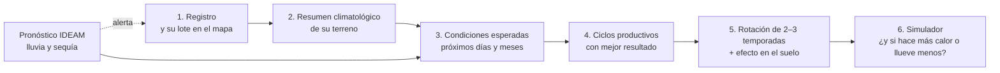
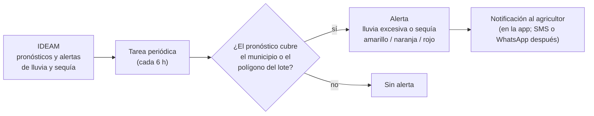
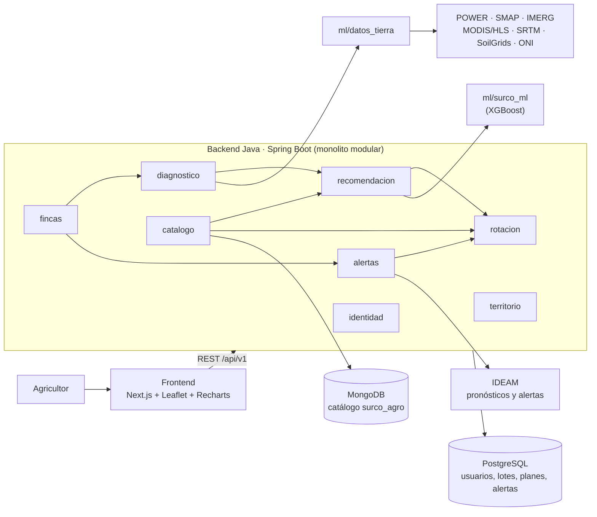

# SURCO · Field Shift 🌱🛰️

**Vamos a desarrollar una herramienta de apoyo a la decisión que le recomiende al agricultor los ciclos productivos que mejor resultado le pueden dar en su terreno, según las condiciones meteorológicas que se van a presentar, combinando observaciones de la Tierra de la NASA, pronósticos del IDEAM, información local del suelo y las características de cada cultivo, en rotaciones que fortalezcan la salud de su suelo.**

Proyecto del equipo **Nameless** para el **NASA Space Apps Challenge 2026**, reto **[Field Shift: Adapting Farms with NASA Data](docs/00-reto.md)**.

> Agricultor → problema → dato NASA → decisión → resultado.
> *"El IDEAM pronostica lluvias por debajo de lo normal en su municipio los próximos tres meses y SMAP muestra que la humedad del suelo de su lote está en 0,12 m³/m³. Con esas condiciones, esta temporada le va mejor el fríjol que el maíz: termina el ciclo bien 8 de cada 10 años, necesita menos riego y le deja nitrógeno al suelo para el maíz de la siguiente temporada, cuando se esperan más lluvias."*

**Estado:** 🟡 en desarrollo. La estructura del proyecto está lista; el código de datos, modelo y backend que ya construimos en [Nasa_2026_Nameless](https://github.com/EdwinSteve/Nasa_2026_Nameless) se migra a esta estructura, y sobre él se desarrollan la rotación y las alertas. Ver el [plan de desarrollo](#6-plan-de-desarrollo).

---

## 1. El reto

> *Farmers around the world navigate shifting temperatures, changing rainfall patterns, water shortages, extreme weather, and declining soil health. These pressures make it difficult to choose crop rotations that protect fields, conserve water, and support long-term resilience. Your challenge is to create a decision-support tool that uses NASA Earth observations along with local soil information, crop characteristics, and farmer priorities to help farmers explore rotation strategies that could strengthen soil health and adapt their farms to changing conditions.*

En pocas palabras: los agricultores enfrentan temperaturas que cambian, lluvias irregulares, escasez de agua, eventos extremos y suelos cada vez más pobres. Con esa presión es difícil elegir una rotación que proteja el lote, ahorre agua y sostenga la finca a largo plazo. El reto pide una herramienta que combine **datos NASA**, **suelo local**, **características de los cultivos** y lo que necesita el agricultor para **explorar estrategias de rotación** que **fortalezcan el suelo** y **adapten la finca**.

Nuestra lectura: lo que el agricultor necesita es saber **qué ciclo productivo le va a dar mejor resultado con el clima que viene**. Por eso SURCO no le pide ordenar prioridades: el objetivo es fijo, el mejor resultado productivo adaptado a las condiciones meteorológicas esperadas en su terreno. Lo que el agricultor aporta es su lote, si tiene riego y desde cuándo puede sembrar.

## 2. Para quién y qué problema resolvemos

**Usuario:** el pequeño y mediano productor de **cualquier departamento y municipio de Colombia** que hoy siembra el mismo cultivo año tras año en el mismo lote. Empezamos validando en el **Huila**, donde el monocultivo de café y arroz del valle del Magdalena es muy sensible a El Niño y La Niña y tiene estrés hídrico en aumento.

**Problema:** decide qué sembrar sin saber qué clima viene ni cómo le va a ir a cada cultivo con ese clima. Los datos satelitales que podrían ayudarle exigen ser científico de datos, y los pronósticos oficiales del IDEAM rara vez llegan hasta su finca. Repetir el mismo cultivo agota el suelo, concentra plagas y lo deja expuesto a una sola mala temporada.

**Lo que SURCO le va a responder**, en español y en palabras sencillas:

1. **¿Cómo ha sido y cómo está el clima de mi terreno?**
2. **¿Qué clima viene para mi finca en los próximos días y meses?**
3. **¿Qué ciclo productivo me va a dar mejor resultado con ese clima, y cuándo lo siembro?**
4. **¿Qué rotación de 2–3 temporadas se adapta mejor a lo que viene?**
5. **¿Qué le hace esa rotación a mi suelo?**
6. **¿Y si el clima cambia más de lo esperado?**
7. **¿Viene lluvia fuerte o sequía a mi finca?**

## 3. Qué vamos a desarrollar

### 3.1 El recorrido del agricultor



### 3.2 Funcionalidades

| # | Funcionalidad | Qué va a hacer | Requisito del reto |
|---|---|---|---|
| 1 | **Registro de la finca y el lote** | El agricultor crea su cuenta, ubica su finca (departamento, municipio y vereda, en cualquier parte de Colombia), dibuja el lote en el mapa e indica si tiene riego y desde cuándo puede sembrar. El sistema calcula el área, el punto medio y la altitud. | Información local, lo que necesita el agricultor |
| 2 | **Condiciones meteorológicas esperadas** | Para el periodo de cada ciclo, estima cómo va a estar el clima del lote: pronóstico del IDEAM para los próximos días y meses, predicción estacional del modelo (clima reciente + El Niño/La Niña) y climatología histórica del lote. | Temperaturas y lluvias que cambian |
| 3 | **Resumen climatológico del terreno** | Reúne la información disponible para el lote: lluvia y temperatura de los últimos 45 años y su tendencia (POWER, IMERG), humedad del suelo en la zona de raíces (SMAP), verdor (MODIS/HLS) y suelo (SoilGrids). Cada dato muestra su fuente y su fecha. | NASA Earth observations, suelo local |
| 4 | **Ciclos productivos recomendados** | Un modelo predictivo (XGBoost) anticipa cómo le irá a cada uno de los 44 cultivos del catálogo con las condiciones esperadas, para cada fecha de siembra posible: idoneidad, probabilidad de éxito ("8 de cada 10 años"), riego necesario y días de estrés. Recomienda los ciclos (cultivo + fecha de siembra) con mejor resultado. | Crop characteristics |
| 5 | **Rotación adaptada** | Encadena los mejores ciclos en secuencias de 2–3 temporadas, cada una adaptada al clima esperado en su periodo, ordenadas por un puntaje 0–100. Cada temporada explica por qué se eligió, con el dato NASA o IDEAM que la motivó. | Explore rotation strategies |
| 6 | **Efecto en la salud del suelo** | Dentro de cada plan, qué le aporta cada temporada al suelo: nitrógeno de las leguminosas, cambio de familia botánica (rompe plagas y enfermedades) y cobertura. | Strengthen soil health |
| 7 | **Simulador de escenarios** | Controles de +0 a +4 °C y −40 % a +20 % de lluvia que recalculan el plan en vivo. | Adapt their farms to changing conditions |
| 8 | **Alertas IDEAM de lluvia y sequía** | Revisa cada 6 h los pronósticos y alertas del IDEAM, los cruza con la ubicación de cada finca y le avisa al agricultor cuando el clima de su finca puede cambiar (nivel amarillo, naranja o rojo). Si el pronóstico cambia, la recomendación del lote se recalcula. | Extreme weather, water shortages |

### 3.3 Cómo se va a decidir la recomendación

1. **Condiciones esperadas:** para cada fecha de siembra posible, se arma el clima esperado del ciclo con el pronóstico del IDEAM (corto plazo), la predicción estacional del modelo y la climatología del lote.
2. **Filtros duros:** se descartan los cultivos que no toleran la altitud, el pH, el agua disponible en secano o el calor extremo del lote, y los de la misma familia botánica que el cultivo anterior.
3. **Puntaje por criterio** bajo esas condiciones, normalizado a [0, 1]:

   | Criterio | Qué mide | Dato principal |
   |---|---|---|
   | Clima | Qué tan bien encaja el cultivo con el clima esperado en cada fase y su probabilidad de éxito | Modelo predictivo (POWER + ONI) + pronóstico IDEAM |
   | Agua | Riego que va a necesitar frente a la humedad disponible | SMAP, IMERG, balance hídrico FAO-56 |
   | Suelo | pH, textura y nitrógeno que aporta o consume | SoilGrids + catálogo |
   | Diversidad | Familias botánicas distintas a lo largo del plan | Catálogo |

4. **Puntaje global:** `w_clima·clima + w_agua·agua + w_suelo·suelo + w_div·diversidad`, con pesos fijos definidos en configuración y calibrados para premiar el mejor resultado productivo con el clima esperado. Se expresa de 0 a 100 con un grado (A+/A/B).
5. **Rotación:** se encadenan los ciclos de mejor puntaje sin repetir familia botánica, de modo que cada temporada caiga en el periodo cuyo clima esperado mejor le sirve.
6. **Explicación:** cada temporada muestra el valor NASA o IDEAM que la produjo y su fuente.

Las reglas y sus razones están en las decisiones [0001](docs/decisiones/) (motor MCDA explicable) y [0003](docs/decisiones/) (modelo predictivo entrenado con un oráculo agronómico).

### 3.4 Cómo van a funcionar las alertas



Cada alerta guarda su fuente, su vigencia y el boletín de origen, y no se notifica dos veces. El mismo pronóstico alimenta las condiciones esperadas de la recomendación. Qué fuentes del IDEAM se usan y sus limitaciones: [ADR 0006](docs/decisiones/0006-alertas-ideam.md).

### 3.5 Pantallas

| Pantalla | Ruta | Qué muestra |
|---|---|---|
| Bienvenida | `/` | Qué es SURCO, en tres pasos |
| Registro e ingreso | `/registro`, `/ingresar` | Cuenta con celular y contraseña, y la política de datos |
| Inicio | `/inicio` | El estado de su lote hoy y las alertas pendientes |
| Mis lotes | `/lotes` | Mapa para dibujar el lote, tipo de riego y desde cuándo puede sembrar |
| Resumen climatológico | `/lotes/[id]/diagnostico` | Lluvia, temperatura, humedad, verdor y suelo, con su fuente |
| Recomendación | `/lotes/[id]/rotacion` | Clima esperado, ciclos productivos recomendados, rotación de 2–3 temporadas, efecto en el suelo y simulador |
| Alertas | `/alertas` | Pronósticos de lluvia y sequía del IDEAM para sus fincas |
| Perfil | `/perfil` | Datos de la cuenta |

### 3.6 API planeada (`/api/v1`)

| Módulo | Método y ruta | Qué hace |
|---|---|---|
| `identidad` ✅ | `POST /auth/registro` · `/auth/login` · `/auth/refresh` · `/auth/logout` · `/auth/logout-todo` · `GET /usuarios/me` · `GET /politicas/vigente` | Cuenta y sesión con JWT (implementado, ver [backend/README.md](backend/README.md)) |
| `territorio` ✅ | `GET /territorio/departamentos` · `GET /territorio/municipios?departamento=` · `GET /territorio/elevacion?lat=&lon=` (pendiente) | Los 33 departamentos y 1.122 municipios de Colombia (DIVIPOLA del DANE) y altitud SRTM |
| `fincas` | `POST /fincas` · `POST /fincas/{id}/lotes` · `GET /lotes/{id}` | Finca y lote con su polígono |
| `diagnostico` | `POST /lotes/{id}/diagnostico` · `GET /lotes/{id}/diagnostico/{tarea}` | Resumen climatológico del lote (en segundo plano) |
| `catalogo` | `GET /cultivos` · `GET /cultivos/{id}` | Ficha agronómica de cada cultivo |
| `recomendacion` | `POST /lotes/{id}/recomendaciones` · `GET .../{id}` | Cultivos aptos para el lote y la fecha |
| `rotacion` | `POST /lotes/{id}/rotaciones` · `GET .../{id}` | Condiciones esperadas, ciclos recomendados y rotaciones con su puntaje, explicación y efecto en el suelo |
| `rotacion` | `POST /lotes/{id}/rotaciones/simular` | Recalcula el plan con un escenario de temperatura y lluvia |
| `alertas` | `GET /alertas` · `PATCH /alertas/{id}/leida` | Alertas vigentes del productor |
| `alertas` | `GET /lotes/{id}/pronostico` | Pronóstico vigente del IDEAM para el lote |

Toda ruta exige `Authorization: Bearer <access_token>` salvo registro, login, política de datos y territorio. Los errores siempre llegan como `{ "code", "message", "details"? }`.

## 4. Fuentes de datos

| Fuente | Variable | Para qué la vamos a usar |
|---|---|---|
| **NASA POWER** (1981–hoy) | Temperatura, lluvia, humedad relativa, viento, radiación | Clima histórico del terreno, grados-día, ET0 FAO-56. Temperatura corregida por elevación (ADR 0002). |
| **NASA SMAP L3/L4** | Humedad del suelo en superficie y zona de raíces | Agua disponible al sembrar; filtro de cultivos en secano. |
| **NASA GPM IMERG** | Lluvia satelital | Lluvia reciente de 30 y 90 días. |
| **NASA MODIS / HLS** (Landsat + Sentinel-2) | NDVI, temperatura de superficie (LST) | Verdor del lote y estrés por calor. |
| **NASA SRTM** | Elevación | Corrección de temperatura y filtro de altitud. |
| **SoilGrids (ISRIC)** | Textura, pH, carbono orgánico, N, CEC | Suelo local del lote. |
| **NOAA ONI** | Índice El Niño / La Niña | Predictibilidad estacional en Colombia. |
| **IDEAM** | Pronósticos y alertas de lluvia y sequía | Alertas al agricultor sobre su finca. |

Respaldo del enfoque: **NASA Harvest** y **NASA Acres**. Estado y limitaciones de cada fuente en [docs/datos/](docs/datos/).

## 5. Arquitectura

SURCO va a ser un **monolito modular**: una sola aplicación que se despliega como una unidad, dividida en módulos independientes por área de negocio. Cada módulo tiene cuatro capas (arquitectura hexagonal) y solo habla con otros módulos a través de su API pública. Así el proyecto es fácil de mantener sin la complejidad de los microservicios.



| Módulo | Responsabilidad |
|---|---|
| `identidad` ✅ | Registro, login y sesiones con JWT (access + refresh con rotación); consentimiento de la política de datos. |
| `territorio` ✅ | Los 33 departamentos y 1.122 municipios de Colombia (DIVIPOLA del DANE); elevación SRTM pendiente. |
| `fincas` | Fincas, lotes (polígono, área, centroide) y tipo de riego. |
| `diagnostico` | Resumen de la información climatológica disponible para el lote, y su suelo. |
| `catalogo` | Requerimientos de 44 cultivos por fase (temperatura, lluvia, Kc, raíz, familia botánica). Solo lectura. |
| `recomendacion` | Cultivos aptos para el lote y la fecha según el modelo predictivo. |
| `rotacion` | Condiciones esperadas del lote, ciclos productivos con mejor resultado, rotación de 2–3 temporadas, efecto en el suelo y simulador. **El núcleo del reto.** |
| `alertas` | Pronósticos del IDEAM de lluvia y sequía cruzados con cada finca, notificaciones al agricultor y el pronóstico del lote para `rotacion`. |

Reglas, anatomía de un módulo y cómo se comunican: [docs/arquitectura.md](docs/arquitectura.md).

**Stack:** Next.js 15, React 19, TypeScript, Tailwind 4, Leaflet y Recharts en el frontend · **Java 21 y Spring Boot 4** (Spring Security con JWT, Spring Data JPA, Flyway, JUnit 5 y ArchUnit) en el backend · Python con `earthengine-api`, `earthaccess`, XGBoost y SHAP para datos y modelo (`ml/`) · PostgreSQL 16 (un esquema por módulo) y MongoDB (catálogo).

## 6. Plan de desarrollo

| Fase | Qué se entrega | Origen |
|---|---|---|
| **0. Base** | Monolito modular en Spring Boot, reglas de arquitectura con ArchUnit | ✅ Hecho |
| **1a. Identidad y territorio** | Registro, login, JWT con refresh rotativo, perfil; departamentos y municipios de Colombia; pantallas de registro e ingreso | ✅ Hecho |
| **1b. Migración** | `fincas`, `diagnostico` y `recomendacion` en Java; `ml/datos_tierra`, `ml/surco_ml` y el catálogo de 44 cultivos | Ya desarrollado en Nasa_2026_Nameless (Python): se porta o se consume desde Java |
| **2. Resumen climatológico** | `diagnostico` reenfocado como resumen climatológico del terreno con tendencias | Ajuste de lo existente |
| **3. Pronóstico y alertas IDEAM** | Fuente de pronósticos, cruce con lotes, tarea periódica, notificaciones y pronóstico del lote | Nuevo |
| **4. Recomendación y rotación** | Condiciones esperadas, ciclos con mejor resultado, rotación de 2–3 temporadas, efecto en el suelo y simulador | Nuevo, sobre el modelo predictivo existente |
| **5. Frontend** | Pantallas de la sección 3.5 contra la API real | Se reutilizan componentes del repo anterior |
| **6. Presentación** | Fincas demo pre-descargadas, video de 30 s, página del proyecto | Nuevo |

El detalle por tarea vive en los issues del repositorio; cada tarea va en su rama y entra por Pull Request.

### Fuera del alcance inicial

Un panel de métricas de impacto acumulado de la finca (agua ahorrada y nitrógeno fijado a lo largo de los años) y el asistente conversacional en español. La arquitectura permite agregarlos después como módulos nuevos sin tocar los existentes.

## 7. Estructura del repositorio

```
.
├── backend/                 API Java 21 · Spring Boot 4 (monolito modular)
│   ├── src/main/java/co/surco/
│   │   ├── compartido/      seguridad JWT, errores, salud (sin negocio)
│   │   └── <modulo>/        identidad, territorio, fincas, diagnostico, catalogo, recomendacion, rotacion, alertas
│   │       ├── (raíz)           API pública del módulo
│   │       ├── dominio/         entidades, reglas y puertos (Java puro)
│   │       ├── aplicacion/      casos de uso
│   │       ├── infraestructura/ adaptadores: PostgreSQL, Mongo, NASA, IDEAM, modelo
│   │       └── api/             controladores REST y DTOs
│   ├── src/main/resources/  application.yml, migraciones Flyway, DIVIPOLA
│   ├── src/test/            unitarias, JWT, ArchUnit (sin BD) · *IT contra PostgreSQL
│   └── compose.yaml         PostgreSQL 16 para desarrollo y pruebas
│
├── frontend/                Next.js
│   └── src/
│       ├── app/             rutas: páginas delgadas que componen módulos
│       ├── modulos/         uno por módulo del backend: componentes, hooks, api.ts, tipos.ts
│       └── compartido/      cliente HTTP, UI genérica, mapa, gráficas, utilidades
│
├── ml/                      servicio de datos (datos_tierra) y modelo predictivo (surco_ml)
├── data/                    catálogo de cultivos, fincas demo, datos procesados
├── docs/                    reto, arquitectura, decisiones (ADR), datos, bitácora
└── scripts/                 descarga de fuentes NASA y de la DIVIPOLA del DANE
```

## 8. Cómo correrlo

Requisitos: **Java 21**, **Node 20+** y **Docker** (para PostgreSQL). Maven no hace falta: el backend trae `./mvnw`.

```bash
# Backend  →  http://localhost:8080
cd backend
docker compose up -d          # PostgreSQL 16 (bases surco y surco_test)
cp .env.example .env          # ponga JWT_SECRETO: openssl rand -base64 48
./mvnw spring-boot:run

# Frontend  →  http://localhost:3000 (reenvía /api/v1 al backend)
cd ../frontend
cp .env.example .env.local
npm install
npm run dev
```

```bash
cd backend && ./mvnw test      # dominio, JWT y arquitectura (sin BD)
cd backend && ./mvnw verify    # además la API completa contra PostgreSQL
cd frontend && npm test
```

La guía para proteger las rutas de un módulo nuevo con el JWT está en [backend/README.md](backend/README.md#cómo-proteger-las-rutas-de-un-módulo-nuevo).

## 9. Cómo trabajamos

- `main` siempre funciona. Cada tarea va en una rama (`feat/rotacion-mcda`, `feat/alertas-ideam`, `migra/diagnostico`) y entra por Pull Request.
- Una funcionalidad nueva vive en **un** módulo. Si toca dos, se comunican por la API pública del módulo (su paquete raíz, como `co.surco.territorio.ConsultaTerritorio`), nunca por sus capas internas. `ArquitecturaTest` lo vigila.
- Toda ruta nueva queda protegida con JWT sin hacer nada; para abrir una sin sesión hay que justificarlo en el PR.
- Las decisiones importantes se registran en `docs/decisiones/NNNN-titulo.md` ([plantilla](docs/decisiones/0000-plantilla.md)); lo que se hizo en cada período, en `docs/bitacora/`.
- Los textos para el agricultor van de **usted**, en palabras sencillas; los nombres técnicos (NASA SMAP, POWER, IDEAM) solo aparecen como fuente del dato.

## 10. Alcances y límites

- SURCO **apoya** la decisión del agricultor; no reemplaza la asesoría de un técnico agrícola local.
- NASA POWER es un dato en grilla (~50 km), no una medición del lote; por eso se corrige la temperatura por elevación y se combina con SMAP, IMERG y SoilGrids.
- Los umbrales del catálogo se validan con rendimientos reales (EVA, GDHY) antes de presentarlos como recomendación firme.

## 11. Entregables del reto

- [ ] Página del proyecto en el sitio de Space Apps
- [ ] Repositorio público (open source) enlazado desde la página
- [ ] Video corto (lo clave se entiende en los primeros 30 s)
- [ ] Demo funcional, con fincas demo pre-descargadas para no depender de la red

Criterios de evaluación: **Impact · Creativity · Validity · Relevance · Presentation**.

## 12. Equipo y licencia

Equipo **Nameless** · NASA Space Apps Challenge 2026.
Código bajo licencia [MIT](LICENSE). Los datos de la NASA son de dominio público; SoilGrids se distribuye bajo CC BY 4.0; los datos del IDEAM se usan según los términos de datos abiertos de Colombia.
