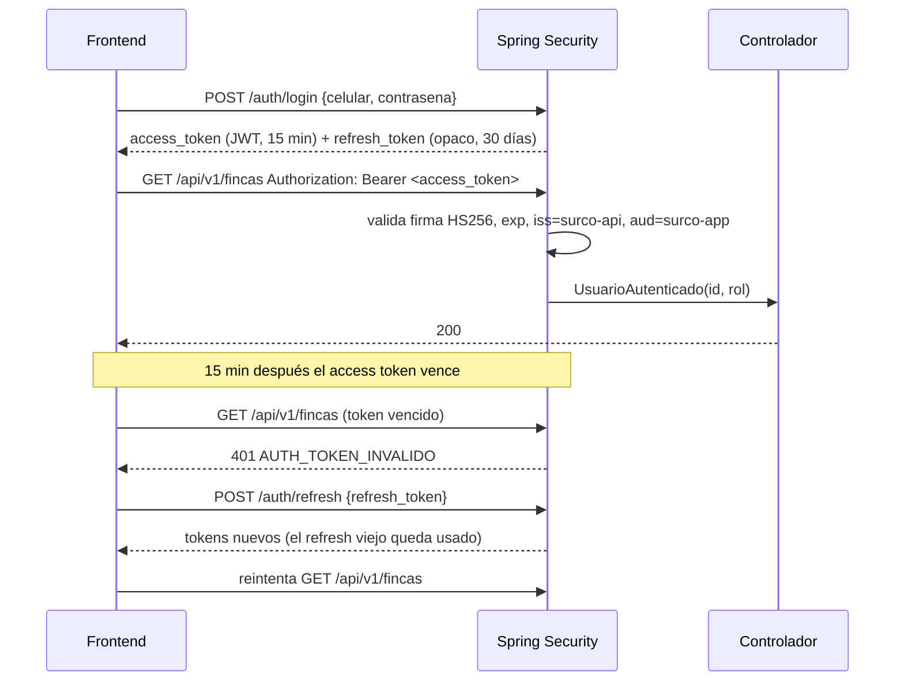

# Backend SURCO (Java 21 · Spring Boot 4)

API REST de SURCO. Es un **monolito modular** con arquitectura hexagonal: cada paquete directo de `co.surco` es un módulo con sus capas `dominio`, `aplicacion`, `infraestructura` y `api`, y su propio esquema de PostgreSQL. Reglas en [docs/arquitectura.md](../docs/arquitectura.md); la decisión de autenticación en la [ADR 0007](../docs/decisiones/0007-autenticacion-jwt-spring.md).

| Módulo | Estado | Qué hace |
|---|---|---|
| `compartido` | ✅ | Seguridad JWT, formato de errores, salud. No tiene negocio. |
| `identidad` | ✅ | Registro, login, refresh, logout, perfil y política de datos |
| `territorio` | ✅ | 33 departamentos y 1.122 municipios de Colombia (DIVIPOLA del DANE) |
| `fincas`, `diagnostico`, `catalogo`, `recomendacion`, `rotacion`, `alertas` | ⏳ | Por construir; cada paquete tiene un `package-info.java` con su responsabilidad |

## Cómo correrlo

Requisitos: **Java 21** y **Docker** (para PostgreSQL). No hace falta instalar Maven: el proyecto trae `./mvnw`.

```bash
cd backend
docker compose up -d                 # PostgreSQL 16 con las bases surco y surco_test
cp .env.example .env                 # y ponga un JWT_SECRETO: openssl rand -base64 48
./mvnw spring-boot:run               # http://localhost:8080
```

Flyway crea las tablas al arrancar. La API **no arranca** sin `JWT_SECRETO` o si tiene menos de 64 caracteres, y el mensaje de error nunca muestra el valor.

| Variable | Por defecto | Qué es |
|---|---|---|
| `JWT_SECRETO` | — (obligatoria) | Clave HMAC para firmar los JWT. Una distinta por ambiente. Si cambia, todas las sesiones se cierran. |
| `DATABASE_URL` / `DATABASE_USER` / `DATABASE_PASSWORD` | `jdbc:postgresql://localhost:5432/surco` · `surco` · `surco` | Conexión a PostgreSQL |
| `CORS_ORIGENES` | `http://localhost:3000` | Orígenes que pueden llamar a la API desde el navegador |
| `PORT` | `8080` | Puerto HTTP |

Las duraciones (`surco.jwt.duracion-acceso: 15m`, `duracion-refresco: 30d`) y el bloqueo (`surco.ingreso.maximo-intentos: 5`, `duracion-bloqueo: 15m`) están en `src/main/resources/application.yml`.

## Endpoints (`/api/v1`)

| Método | Ruta | Acceso | Respuesta |
|---|---|---|---|
| GET | `/health` | pública | `{"status":"ok"}` |
| GET | `/politicas/vigente` | pública | Versión, URL y texto de la política de datos |
| GET | `/territorio/departamentos` | pública | Los 33 departamentos |
| GET | `/territorio/municipios?departamento=05` | pública | Municipios del departamento · 404 si no existe |
| POST | `/auth/registro` | pública | **201** `{usuario, tokens}` · 400/409/422 por campo |
| POST | `/auth/login` | pública | 200 tokens · **401** `AUTH_CREDENCIALES_INVALIDAS` · **423** `AUTH_CUENTA_BLOQUEADA` |
| POST | `/auth/refresh` | pública (refresh token) | 200 tokens nuevos; el refresh enviado deja de servir · 401 `AUTH_REFRESH_INVALIDO` |
| POST | `/auth/logout` | pública (refresh token) | 204. Cierra esta sesión |
| POST | `/auth/logout-todo` | **Bearer** | 204. Cierra todas las sesiones del usuario |
| GET | `/usuarios/me` | **Bearer** | Perfil del usuario de la sesión |

```jsonc
// POST /auth/registro
{ "nombre_completo": "Ana Perdomo", "celular": "300 123 4567", "correo": null,
  "contrasena": "MiFinca2026", "municipio_residencia": "52356",
  "acepta_politica": true, "version_politica": "1.0" }

// Respuesta de /auth/login y /auth/refresh (y "tokens" del registro)
{ "access_token": "eyJhbGciOiJIUzI1NiJ9...", "refresh_token": "Xk3...", "token_type": "bearer", "expira_en": 900 }
```

El JSON va en **snake_case**. Los errores siempre llegan como `{"code", "message", "details"?: [{"field", "message"}]}`, con `field` en el nombre del JSON (`nombre_completo`), así el frontend pinta cada error junto a su campo.

## Cómo funciona la sesión



- **Access token**: JWT firmado con HS256. Claims: `sub` (id del usuario), `rol`, `iss`, `aud`, `iat`, `exp`, `jti`. **Nunca** lleva celular, nombre ni otros datos personales, porque un JWT se puede leer aunque no se pueda falsificar.
- **Refresh token**: 256 bits aleatorios. En la base solo se guarda su hash SHA-256. Sirve **una vez**: al usarlo se emite otro de la misma familia. Si un refresh token ya usado vuelve a llegar, alguien lo copió, así que se revoca la familia entera.
- **Contraseñas**: BCrypt (`{bcrypt}$2a$10$...`). Tras 5 fallos seguidos la cuenta se bloquea 15 minutos. El error es el mismo si el celular no existe o la contraseña está mal, y el tiempo de respuesta también.
- **Cerrar sesión** revoca los refresh tokens. El access token sigue válido hasta que vence (máximo 15 min): por eso es corto.

El frontend ya hace todo esto: agrega el token, lo renueva al recibir 401 y reintenta (`frontend/src/compartido/api/http.ts`).

## Cómo proteger las rutas de un módulo nuevo

**Toda ruta exige un JWT válido por defecto.** Un controlador nuevo queda protegido sin configurar nada; no hace falta escribir filtros ni middlewares.

### 1. Recibir al usuario autenticado

```java
package co.surco.fincas.api;

import co.surco.compartido.seguridad.UsuarioAutenticado;
import org.springframework.security.core.annotation.AuthenticationPrincipal;

@RestController
@RequestMapping("/api/v1/fincas")
class FincasControlador {

    private final ListarFincas listarFincas;   // caso de uso del módulo (capa aplicacion)

    FincasControlador(ListarFincas listarFincas) {
        this.listarFincas = listarFincas;
    }

    @GetMapping
    List<FincaRespuesta> misFincas(@AuthenticationPrincipal UsuarioAutenticado usuario) {
        // usuario.id() sale del token ya validado: es imposible falsificarlo desde el cliente
        return listarFincas.de(usuario.id()).stream().map(FincaRespuesta::de).toList();
    }
}
```

Reglas:
- **Filtre siempre por `usuario.id()`.** Nunca tome el id del usuario de la URL ni del cuerpo.
- Si un recurso es de otro usuario, responda **404** como si no existiera, no 403: así no se revela que existe.

```java
Finca finca = fincas.porId(fincaId)
    .filter(f -> f.propietarioId().equals(usuario.id()))
    .orElseThrow(() -> new ErrorDominio("FINCA_NO_ENCONTRADA", "Esa finca no existe.", TipoError.NO_ENCONTRADO));
```

### 2. Exigir un rol

```java
@PostMapping("/api/v1/catalogo/cultivos")
@PreAuthorize("hasRole('ADMIN')")           // 403 AUTH_SIN_PERMISO para un PRODUCTOR
CultivoRespuesta crear(@Valid @RequestBody CultivoSolicitud s) { ... }
```

Roles: `PRODUCTOR` (toda cuenta nueva) y `ADMIN` (se asigna a mano: `update identidad.usuarios set rol = 'ADMIN' where celular = '...'`). También sirve `usuario.esAdmin()` dentro del código.

### 3. Abrir una ruta sin sesión (excepcional)

Agréguela a [`RutasPublicas`](src/main/java/co/surco/compartido/seguridad/RutasPublicas.java) y explique en el PR por qué no necesita sesión. Hoy solo son públicas las de registro/login, la política de datos, el territorio y la salud.

### 4. Probarla

[`AutenticacionIT`](src/test/java/co/surco/identidad/api/AutenticacionIT.java) muestra cómo registrar un usuario, tomar su `access_token` y llamar una ruta protegida con `MockMvc`. [`RutasDePrueba`](src/test/java/co/surco/compartido/seguridad/RutasDePrueba.java) tiene una ruta protegida y una de solo ADMIN de ejemplo.

### Respuestas de seguridad

| Caso | HTTP | `code` |
|---|---|---|
| Sin encabezado `Authorization` | 401 | `AUTH_NO_AUTENTICADO` |
| Token vencido, alterado, de otra clave, otro emisor u otra audiencia | 401 | `AUTH_TOKEN_INVALIDO` |
| Token válido sin el rol que pide `@PreAuthorize` | 403 | `AUTH_SIN_PERMISO` |

## Agregar un módulo

1. Cree `dominio`, `aplicacion`, `infraestructura` y `api` dentro de su paquete (ya existe con su `package-info.java`). Copie la forma de `identidad`.
2. Lo que otros módulos puedan usar va en el paquete raíz (`co.surco.fincas.ConsultaFincas`), como hace `territorio` con `ConsultaTerritorio`.
3. Sus tablas van en su propio esquema, con una migración nueva: `src/main/resources/db/migration/V3__fincas.sql`. Nunca edite una migración que ya se aplicó en otro ambiente.
4. `ArquitecturaTest` falla si el dominio importa Spring o JPA, si un módulo usa las capas internas de otro, o si un controlador toca la infraestructura.

## Pruebas

```bash
./mvnw test      # dominio, casos de uso, JWT y arquitectura: sin base de datos (43 pruebas)
./mvnw verify    # además las *IT contra PostgreSQL (surco_test): API completa, 12 pruebas
```

Las pruebas `*IT` vacían las tablas en cada prueba: usan la base `surco_test` del `compose.yaml`. **Nunca** apunte `TEST_DATABASE_URL` a una base con datos reales.

## Estructura

```
src/main/java/co/surco/
├── SurcoApiApplication.java
├── compartido/
│   ├── error/        ErrorDominio, TipoError, ManejadorErrores → {"code","message","details"}
│   ├── seguridad/    ConfiguracionSeguridad, RutasPublicas, UsuarioAutenticado, PropiedadesJwt
│   └── web/          /api/v1/health y el reloj inyectable
├── identidad/
│   ├── dominio/          Usuario, Celular, Correo, SesionRefresco, Puertos, ErroresIdentidad
│   ├── aplicacion/       RegistrarUsuario, IniciarSesion, RefrescarSesion, CerrarSesion, ConsultasIdentidad
│   ├── infraestructura/  persistencia (JPA), seguridad (BCrypt, EmisorJwt), territorio (adaptador)
│   └── api/              AutenticacionControlador, UsuarioControlador
├── territorio/       ConsultaTerritorio (API pública) + dominio, aplicacion, infraestructura, api
└── fincas/ diagnostico/ catalogo/ recomendacion/ rotacion/ alertas/   (por construir)
src/main/resources/
├── application.yml
├── db/migration/     V1__identidad.sql, V2__politica_datos_inicial.sql
└── territorio/divipola.json   (se regenera con scripts/actualizar_divipola.py)
```

## Pendientes de seguridad antes de producción

- **Límite de peticiones** en `/auth/login` y `/auth/registro` por IP (el bloqueo por cuenta no frena a quien prueba muchos celulares).
- **Refresh token en cookie `httpOnly`** en lugar del `localStorage` del navegador, que queda expuesto a un XSS.
- **HTTPS** obligatorio en producción (el token viaja en un encabezado).
- **Revisión legal** del texto de la política de datos (`V2__politica_datos_inicial.sql`).
- **Limpieza periódica** de sesiones vencidas en `identidad.sesiones`.
