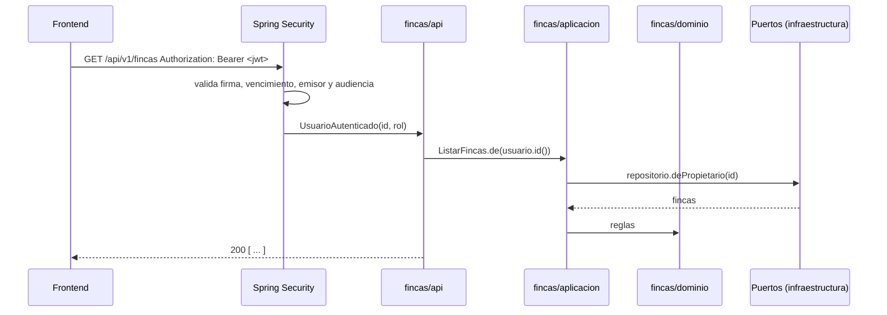

# Arquitectura: monolito modular

SURCO se despliega como **una sola aplicación** (backend Java con Spring Boot y frontend Next.js), dividida en **módulos por área de negocio**. Cada módulo es una pequeña arquitectura hexagonal. Este documento define las reglas; [`ArquitecturaTest`](../backend/src/test/java/co/surco/ArquitecturaTest.java) (ArchUnit) hace cumplir las principales en cada `./mvnw test`.

## 1. Las seis reglas

1. **Un módulo, un área de negocio.** `fincas` sabe de lotes, `rotacion` sabe de rotaciones. Si no sabe dónde va algo, pregúntese qué palabra usaría el agricultor.
2. **El dominio es Java puro.** `dominio/` no importa Spring, JPA, Servlet ni Jackson. Se prueba sin base de datos ni red. *(vigilada)*
3. **Las dependencias apuntan hacia adentro:** `api → aplicacion → dominio ← infraestructura`. La infraestructura implementa los puertos que define el dominio. Los controladores no tocan la infraestructura. *(vigilada)*
4. **Los módulos se hablan por su API pública**, que es el paquete raíz del módulo (`co.surco.territorio.ConsultaTerritorio`). Nadie importa `co.surco.territorio.dominio...` desde otro módulo. *(vigilada)*
5. **Cada módulo es dueño de sus datos:** su propio esquema en PostgreSQL (`identidad`, `fincas`...). Ningún módulo lee las tablas de otro.
6. **Toda ruta exige un JWT** salvo las de `RutasPublicas`. Ver la [ADR 0007](decisiones/0007-autenticacion-jwt-spring.md) y la [guía para proteger rutas](../backend/README.md#cómo-proteger-las-rutas-de-un-módulo-nuevo).

## 2. Anatomía de un módulo

```
co/surco/identidad/
├── (raíz)              API pública: interfaces y records que otros módulos pueden usar
├── dominio/
│   ├── Usuario.java          entidad con sus reglas (bloqueo por intentos)
│   ├── Celular.java          objeto de valor (normaliza +57, valida el formato)
│   ├── SesionRefresco.java   refresh token con rotación
│   ├── ErroresIdentidad.java errores de negocio (extienden ErrorDominio)
│   └── Puertos.java          interfaces: RepositorioUsuarios, CifradorContrasenas, EmisorTokensAcceso...
├── aplicacion/
│   └── IniciarSesion.java    casos de uso: @Service + @Transactional, reciben los puertos por constructor
├── infraestructura/
│   ├── persistencia/         entidades JPA (esquema "identidad") y adaptadores de los repositorios
│   ├── seguridad/            BCrypt y emisor de JWT
│   └── territorio/           adaptador que usa la API pública de otro módulo
└── api/
    ├── AutenticacionControlador.java   rutas HTTP
    └── Dtos.java                       records de entrada y salida (JSON en snake_case)
```

`compartido/` tiene solo lo transversal y sin negocio: la seguridad JWT, el formato de errores y la salud. No depende de ningún módulo. *(vigilada)*

## 3. Flujo de una petición protegida



Sin token, o con uno inválido, la petición no llega al controlador: Spring Security responde 401 en JSON.

## 4. Cómo se comunican los módulos

| Consumidor | Necesita | De | Cómo |
|---|---|---|---|
| `identidad` | ¿existe el municipio? | `territorio` | `ConsultaTerritorio` (implementado) |
| `fincas` | validar el municipio de la finca | `territorio` | `ConsultaTerritorio` |
| `diagnostico` | punto medio del lote | `fincas` | API pública de `fincas` |
| `recomendacion` | centroide y riego del lote | `fincas` | `ConsultaTerrenos` (implementado) |
| `recomendacion` | puntajes, filtros duros y familias por cultivo | planificador (`ml/planificador`) | HTTP, `ClientePlanificador` (implementado); el catálogo lo lee el planificador |
| `rotacion` | ranking, frecuencia histórica y lluvia del lote | `recomendacion` | `ConsultaRecomendaciones` (implementado) |
| `rotacion` | pronóstico IDEAM, diagnóstico | `alertas`, `diagnostico` | un puerto por cada uno (pendiente) |
| `alertas` | ubicación de los lotes y su productor | `fincas` | API pública de `fincas` |

Cada módulo define un **puerto** en su dominio y lo implementa en su infraestructura con la API pública del otro módulo, como hace `ValidadorMunicipiosTerritorio`. Así se prueba con dobles en memoria, y si algún día un módulo sale a un servicio aparte, solo cambia el adaptador.

El modelo predictivo y el servicio de datos de la NASA siguen en Python (`ml/`). `recomendacion` llama al planificador estacional (servicio `surco-planificador` de `compose.yaml`) desde `infraestructura/planificador`; el resto del backend no sabe que existe. Qué motor sirve y cómo se arman las rotaciones: [ADR 0008](decisiones/0008-recomendacion-y-rotacion.md).

## 5. Frontend

El frontend replica los módulos del backend:

- `src/app/` solo tiene rutas; cada `page.tsx` es delgada y compone componentes de los módulos.
- `src/modulos/<modulo>/` agrupa `componentes/`, `hooks/`, `api.ts` (llamadas HTTP) y `tipos.ts` (espejo de los DTOs). Las páginas importan solo desde su `index.ts`.
- `src/compartido/` tiene el cliente HTTP (agrega el JWT y renueva la sesión), la UI genérica, el mapa y las gráficas.

## 6. Agregar un módulo

1. Cree las capas dentro de `backend/src/main/java/co/surco/<modulo>/` (el paquete ya existe con su `package-info.java`).
2. Cree su esquema con una migración nueva de Flyway (`V<n>__<modulo>.sql`).
3. Sus rutas quedan protegidas solas; lea al usuario con `@AuthenticationPrincipal UsuarioAutenticado`.
4. Cree `frontend/src/modulos/<modulo>/` si tiene pantallas.
5. Si la decisión no es obvia, escriba una ADR en `docs/decisiones/`.
