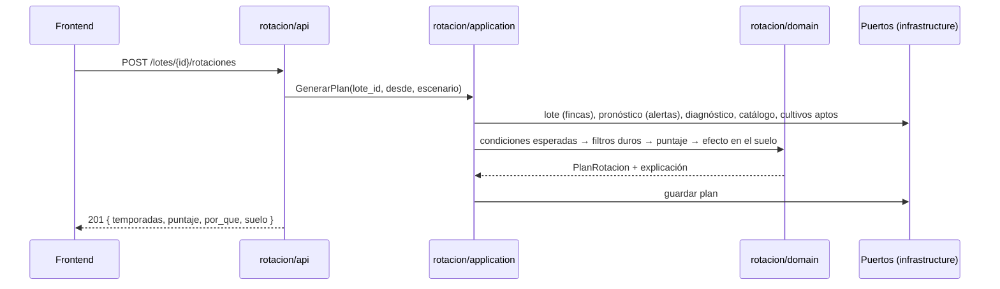

# Arquitectura: monolito modular

SURCO se despliega como **una sola aplicación** (un backend, un frontend), dividida en **módulos por área de negocio**. Cada módulo es una pequeña arquitectura hexagonal. Este documento define las reglas; el código las sigue y `backend/tests/test_arquitectura.py` vigila las dos más importantes.

## 1. Las cinco reglas

1. **Un módulo, un área de negocio.** `fincas` sabe de lotes, `rotacion` sabe de rotaciones. Si no sabes dónde va algo, pregúntate qué palabra usaría el agricultor.
2. **El dominio es Python puro.** `domain/` no importa FastAPI, SQLAlchemy, Pydantic ni httpx. Se prueba sin base de datos ni red. *(vigilada por test)*
3. **Las dependencias apuntan hacia adentro:** `api → application → domain ← infrastructure`. La infraestructura implementa los puertos que define el dominio.
4. **Los módulos se hablan por su API pública.** Un módulo solo importa `app.modules.<otro>` (lo que exporta su `__init__.py`), nunca `app.modules.<otro>.domain...`. *(vigilada por test)*
5. **Cada módulo es dueño de sus datos:** su propio esquema en PostgreSQL (`fincas`, `rotacion`…). Ningún módulo lee las tablas de otro.

## 2. Anatomía de un módulo

```
app/modules/rotacion/
├── __init__.py            API pública: lo que otros módulos pueden usar
├── domain/
│   ├── entity.py          PlanRotacion, Temporada, CultivoPropuesto
│   ├── reglas.py          filtros duros (familia botánica, pH, agua, calor)
│   ├── condiciones.py     condiciones meteorológicas esperadas del ciclo
│   ├── mcda.py            puntaje 0–100 del resultado esperado
│   ├── suelo.py           efecto de cada temporada sobre el suelo
│   ├── escenarios.py      ΔT y factor de lluvia
│   ├── errors.py          errores de negocio (heredan de ErrorDominio)
│   └── ports.py           Protocols: RepositorioPlanes, ProveedorCatalogo…
├── application/
│   └── casos.py           GenerarPlan, SimularEscenario, ConsultarPlan
├── infrastructure/
│   ├── orm_models.py      tablas del esquema "rotacion"
│   └── repositories.py    implementaciones de los puertos
└── api/
    ├── router.py          rutas HTTP
    ├── schemas.py         Pydantic de entrada/salida
    └── dependencies.py    arma los casos de uso con sus adaptadores
```

`app/core/` solo tiene lo transversal y sin negocio: configuración, sesión de base de datos, formato de errores y validación del token.

## 3. Flujo de una petición



## 4. Cómo se comunican los módulos

| Consumidor | Necesita | De | Cómo |
|---|---|---|---|
| `diagnostico` | punto medio del lote | `fincas` | puerto `ProveedorLotes` implementado con la API pública de `fincas` |
| `recomendacion` | trapecios y filtros por cultivo | `catalogo` | puerto `ProveedorCatalogo` |
| `rotacion` | lote, pronóstico, diagnóstico, cultivos aptos, catálogo | `fincas`, `alertas`, `diagnostico`, `recomendacion`, `catalogo` | un puerto por cada uno |
| `alertas` | ubicación de los lotes y su productor | `fincas` | puerto `ProveedorLotes` |

Así cada módulo se prueba con *fakes* de sus puertos, y si algún día un módulo tiene que salir a un servicio aparte, solo cambia el adaptador.

## 5. Frontend

El frontend replica los módulos del backend:

- `src/app/` solo tiene rutas; cada `page.tsx` es delgada y compone componentes de los módulos.
- `src/modulos/<modulo>/` agrupa `componentes/`, `hooks/`, `api.ts` (llamadas HTTP) y `tipos.ts` (espejo de los schemas). Las páginas importan solo desde su `index.ts`.
- `src/compartido/` tiene el cliente HTTP, la UI genérica, el mapa, las gráficas y los mocks para trabajar sin backend.

## 6. Agregar un módulo nuevo

1. Copiar la estructura de un módulo existente en `backend/app/modules/<nuevo>/`.
2. Montar su router en la lista `ROUTERS` de `backend/app/main.py`.
3. Crear su esquema con una migración de Alembic.
4. Crear `frontend/src/modulos/<nuevo>/` si tiene pantallas.
5. Si la decisión no es obvia, escribir una ADR en `docs/decisiones/`.
