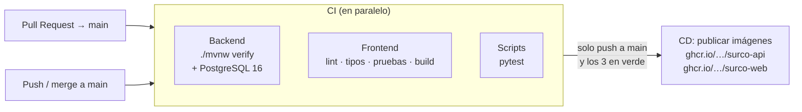

# Integración y entrega continua (CI/CD)

Todo cambio entra a `main` por Pull Request y solo si el CI pasa. Cada push a `main` publica imágenes Docker listas para desplegar.

Workflow: [`.github/workflows/ci-cd.yml`](../.github/workflows/ci-cd.yml).



## 1. Qué revisa el CI

| Job | Qué corre | Falla si |
|---|---|---|
| **Backend · Java 21 + PostgreSQL** | `./mvnw -B -ntp verify` con un PostgreSQL 16 de servicio | Falla una prueba unitaria, de JWT, de arquitectura (ArchUnit) o de integración, o no compila. Si falla, deja los reportes como artefacto `reportes-backend`. |
| **Frontend · lint, tipos, pruebas y build** | `npm ci` · `npm run lint` · `npm run typecheck` · `npm test` · `npm run build` | Hay un error **o una advertencia** de ESLint (`--max-warnings=0`), un error de tipos, una prueba roja o el build de producción falla. |
| **Scripts · Python** | `pytest scripts/tests` | Falla el generador de la DIVIPOLA. |

Para correr lo mismo en su máquina antes de abrir el PR:

```bash
cd backend && docker compose up -d && ./mvnw verify
cd frontend && npm run lint && npm run typecheck && npm test && npm run build
python3 -m pytest scripts/tests
```

## 2. Qué publica el CD

Solo en push a `main` y después de que los tres jobs del CI pasan:

| Imagen | Desde | Etiquetas |
|---|---|---|
| `ghcr.io/<dueño>/surco-api` | `backend/Dockerfile` | `sha-<commit>` y `latest` |
| `ghcr.io/<dueño>/surco-web` | `frontend/Dockerfile` | `sha-<commit>` y `latest` |

- Las imágenes corren con un usuario sin privilegios (uid numérico).
- La de la API no incluye secretos: `JWT_SECRETO` y la base de datos llegan por variables de entorno al desplegar.
- El frontend se compila con `BACKEND_URL=http://surco-api:8080`, el nombre del servicio de la API en Docker Compose o Kubernetes.
- **Despliegue**: falta elegir dónde (Render, Railway, una VM con Docker Compose...). Para desplegar una versión exacta use la etiqueta `sha-<commit>`, no `latest`. Cuando se elija el destino, se agrega un job `desplegar` después de `publicar`.

```bash
docker run -p 8080:8080 \
  -e JWT_SECRETO=... -e DATABASE_URL=jdbc:postgresql://<host>:5432/surco \
  -e DATABASE_USER=surco -e DATABASE_PASSWORD=... \
  ghcr.io/<dueño>/surco-api:sha-<commit>
```

Las imágenes de GHCR nacen **privadas**. Para descargarlas: `docker login ghcr.io` con un token personal con permiso `read:packages`, o hágalas públicas en *Packages → surco-api → Package settings*.

## 3. Proteger `main` (se configura una vez en GitHub)

Esto no se puede poner en un archivo del repositorio: lo hace alguien con permiso de administrador en **Settings → Rules → Rulesets → New ruleset → New branch ruleset**.

1. **Ruleset name**: `main protegida` · **Enforcement status**: Active.
2. **Target branches**: *Add target → Include default branch* (`main`).
3. Active:
   - **Restrict deletions**.
   - **Block force pushes**.
   - **Require a pull request before merging**: 1 aprobación; *Dismiss stale pull request approvals when new commits are pushed*; *Require conversation resolution before merging*.
   - **Require status checks to pass**: *Require branches to be up to date before merging*, y agregue los tres checks (aparecen en la lista después de la primera corrida del workflow):
     - `Backend · Java 21 + PostgreSQL`
     - `Frontend · lint, tipos, pruebas y build`
     - `Scripts · Python`
4. **Create**.

Desde ahí nadie, ni los administradores, puede subir directo a `main` ni fusionar un PR con el CI en rojo.

## 4. Dependencias al día

[Dependabot](../.github/dependabot.yml) abre PRs semanales para Maven, npm, las acciones de GitHub y las imágenes base de Docker. Pasan por el mismo CI, así que una actualización que rompe algo no llega a `main`.

## 5. Decisiones de seguridad del pipeline

- **Acciones fijadas por SHA** (`actions/checkout@3d3c42e…  # v7.0.1`): una etiqueta se puede mover y apuntar a otro código; un SHA no. Dependabot las actualiza.
- **Mínimo privilegio**: el workflow tiene `contents: read`; solo el job `publicar` tiene además `packages: write`.
- **`persist-credentials: false`** en cada checkout: el token de Git no queda guardado en el runner.
- **Sin secretos propios**: las pruebas usan el secreto de `application-test.yml`, que solo sirve en pruebas, y el CD usa el `GITHUB_TOKEN` temporal de cada corrida.
- **`npm ci`** instala exactamente lo del `package-lock.json`.
