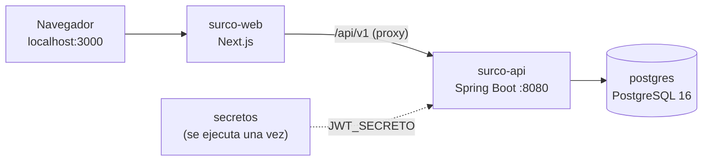

# SURCO con Docker

Todo el proyecto (base de datos, API y frontend) se levanta con un solo comando desde la raíz del repositorio. Solo necesita **Docker** (con Docker Compose v2): no hace falta instalar Java, Maven ni Node.

```bash
docker compose up --build
```

Abra **http://localhost:3000**. La primera vez tarda unos minutos porque descarga dependencias y compila; las siguientes, segundos.

| Comando | Qué hace |
|---|---|
| `docker compose up --build` | Compila y levanta todo, mostrando los logs. `Ctrl+C` lo detiene. |
| `docker compose up --build -d` | Lo mismo, en segundo plano |
| `docker compose logs -f surco-api` | Logs de la API (o `surco-web`, `postgres`) |
| `docker compose down` | Detiene todo. Los datos y el secreto se conservan. |
| `docker compose down -v` | Detiene todo y **borra** la base de datos y el secreto (empezar de cero) |

## Qué levanta



| Servicio | Imagen | Puerto en su máquina | Notas |
|---|---|---|---|
| `secretos` | `alpine` | — | Genera el `JWT_SECRETO` la primera vez y termina |
| `postgres` | `postgres:16-alpine` | — (solo red interna) | Datos en el volumen `surco-datos` |
| `surco-api` | `backend/Dockerfile` | 8080 | Flyway crea las tablas al arrancar |
| `surco-web` | `frontend/Dockerfile` | 3000 | Reenvía `/api/v1` a `surco-api` |

PostgreSQL no se publica en su máquina: así no choca con el de `backend/compose.yaml` ni con otro que tenga instalado.

## El secreto del JWT

La primera vez, el servicio `secretos` genera 64 bytes aleatorios y los guarda en el volumen `surco-secretos`. La API los lee como archivo (Spring `configtree`). Así:

- **Nunca está en el repositorio** ni en un archivo que alguien pueda subir por error.
- **Sobrevive a los reinicios**: `docker compose down` y `up` no cierran las sesiones. Solo `down -v` lo borra.
- **Cada máquina tiene el suyo**.

Para usar un secreto propio (por ejemplo en un servidor), agregue `JWT_SECRETO` en `environment` del servicio `surco-api`: una variable de entorno tiene prioridad sobre el archivo. No la deje vacía, porque una variable vacía también tiene prioridad y la API no arrancaría.

## Desarrollo diario

Docker Compose sirve para correr y mostrar la app. Para programar con recarga automática conviene correr cada parte por separado:

```bash
cd backend && docker compose up -d && ./mvnw spring-boot:run    # solo PostgreSQL en Docker
cd frontend && npm run dev
```

Detalle en [backend/README.md](../backend/README.md) y [frontend/README.md](../frontend/README.md).

## Problemas comunes

| Síntoma | Causa | Solución |
|---|---|---|
| `port is already allocated` en 3000 u 8080 | Otro proceso usa el puerto (un `npm run dev` o `./mvnw spring-boot:run`) | Deténgalo, o cambie el puerto izquierdo en `compose.yaml` (`"3001:3000"`) |
| La página carga pero no salen los departamentos los primeros segundos | La API todavía está arrancando | Espere el `Started SurcoApiApplication` en `docker compose logs surco-api` |
| Cambié código y no se ve | La imagen no se recompiló | Use `--build` |
| Quiero borrar todos los usuarios | — | `docker compose down -v` |

## Producción

Este `compose.yaml` es para desarrollo y demostraciones. En producción:
- Use las imágenes que publica el CI (`ghcr.io/.../surco-api:sha-<commit>`, ver [ci-cd.md](ci-cd.md)).
- Defina un `JWT_SECRETO` propio.
- Use una base de datos administrada con contraseña real.
- Sirva todo por HTTPS.
