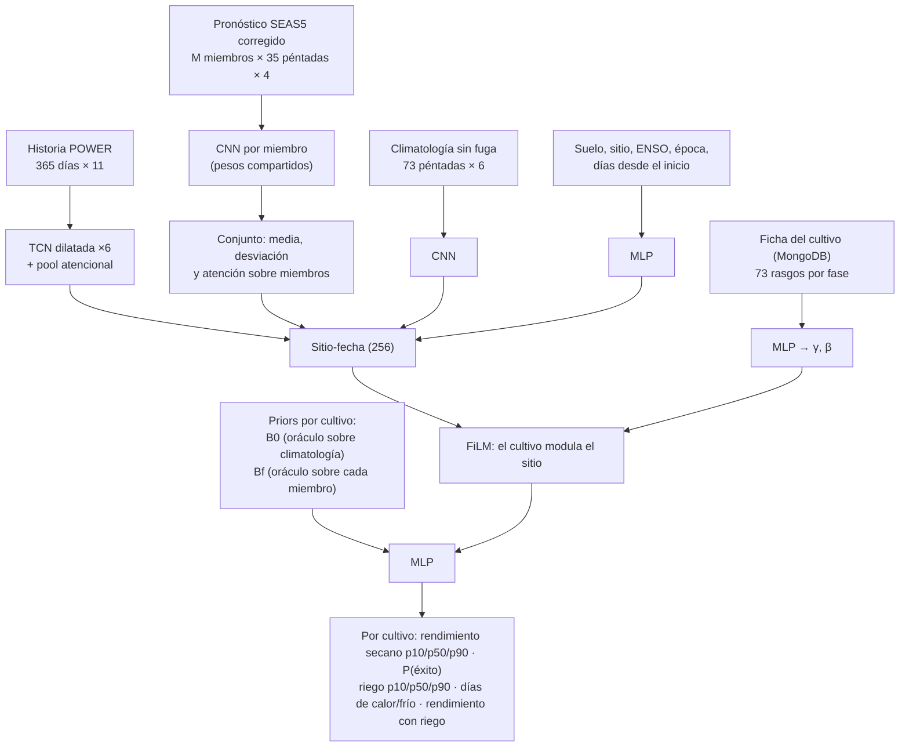

# Investigación: alimentar la red con pronósticos climáticos en vez de solo historia satelital

- **Fecha:** 2026-11-14
- **Pregunta:** ¿Conviene que la red que elige el mejor ciclo productivo para el lote del agricultor
  use **predicciones climatológicas de los próximos meses** en lugar de la información histórica de
  los satélites? Si sí, ¿cómo se entrena para el mejor desempeño posible y cómo se corre después en
  computadores sin tarjeta gráfica?
- **Punto de partida:** CropPlannerNet de FieldPilot (`planner/` en github.com/EdwinSteve/FieldPilot),
  que con 365 días de NASA POWER, la climatología y el ONI le ganó al oráculo climatológico (B0) en
  la prueba 2018–2025 (pinball 0,0209 frente a 0,0342; NDCG@3 0,984 frente a 0,977).

---

## 1. Veredicto

**Sí, con una condición: el pronóstico se agrega a la historia, no la reemplaza.**

| Pregunta | Respuesta corta |
|---|---|
| ¿Se puede entrenar solo con pronósticos? | **No.** Las etiquetas (cómo le fue de verdad al cultivo) salen del clima que ocurrió; la humedad del suelo al sembrar sale del pasado reciente; y el sesgo del pronóstico solo se corrige comparándolo con observaciones. Sin historia no hay con qué entrenar, corregir ni evaluar. |
| ¿Mejora agregar el pronóstico? | **Probablemente sí, sobre todo en años El Niño / La Niña**, en la costa y los Andes colombianos y en DJF. En el oriente del país y en algunas temporadas húmedas de los valles interandinos la habilidad del pronóstico es baja, y ahí la red debe volver a la climatología. |
| ¿Qué pronóstico? | **ECMWF SEAS5 (system 51) de Copernicus C3S**: diario, 215 días de alcance, 51 miembros en tiempo real y **retropronósticos 1981–2016 con 25 miembros**, que son lo que permite entrenar. |
| ¿Y los pronósticos del IDEAM? | Sirven para las **alertas**, pero no para entrenar: no hay un archivo histórico de pronósticos con el que la red aprenda cuánto confiar en ellos. |
| ¿Cómo sabremos si de verdad ayuda? | El script entrena **la misma red sin el pronóstico** (ablación, equivalente a FieldPilot) y compara las dos en 2017–2025, años en que solo existían pronósticos operativos reales, por fase de ENSO. La red solo se adopta si le gana al oráculo con climatología (B0) **y** al oráculo con el pronóstico (Bf). |
| ¿Corre sin GPU? | **Sí.** Medido en este computador (CPU, ONNX Runtime): **13 ms** para puntuar 23 cultivos con 51 miembros usando un conjunto de 2 redes; ~30 ms con las 5 del entrenamiento final. |

---

## 2. Por qué el pronóstico no puede reemplazar la historia

El modelo de FieldPilot veía el futuro solo como **climatología** (el promedio de 30 años para esa
época) más el ONI. Un pronóstico estacional cambia justamente esa parte: en vez de "lo normal en
marzo", dice "lo probable este marzo, dado el estado actual del océano y la atmósfera". Lo demás
sigue necesitando historia:

1. **Etiquetas.** No existe un dataset público de "sembré *c* en la fecha *d* en este lote y coseché
   *y*". Las etiquetas salen de un oráculo FAO (balance hídrico FAO-56, respuesta FAO-33, trapecios
   del catálogo) corrido sobre el clima **que ocurrió** (NASA POWER 1981–2025). Sin historia no hay
   etiquetas.
2. **Condiciones iniciales.** La humedad del suelo y la lluvia de las últimas semanas pesan mucho en
   los primeros 1–2 meses del ciclo, y el pronóstico global (1°) no las conoce en el lote.
3. **Corrección de sesgo.** Un modelo climático a 1° (~110 km) en los Andes tiene errores sistemáticos
   grandes: la celda promedia valles y páramos, y los modelos lloviznan casi todos los días. Solo
   comparando sus retropronósticos con POWER en el punto se pueden corregir.
4. **Aprender la habilidad.** La red tiene que aprender **cuándo y dónde creerle al pronóstico**. Eso
   exige pares (pronóstico emitido en el pasado, lo que pasó) durante décadas: los retropronósticos.

Por eso el diseño ideal es híbrido: **historia (condiciones iniciales) + conjunto de pronóstico
(señal de los próximos meses) + climatología (respaldo cuando el pronóstico no sabe)**.

---

## 3. Qué tan bueno es el pronóstico estacional en Colombia

- **SEAS5 sobre Suramérica (Gubler et al., 2020):** la lluvia es menos predecible que la temperatura.
  La mejor habilidad está **en la costa y las tierras altas de Colombia y Ecuador en diciembre–febrero**,
  ligada a Niño 3.4. Donde el modelo dinámico es hábil, le gana a una predicción empírica basada solo
  en Niño 3.4, que es lo que FieldPilot ya tenía con el ONI.
- **Predictibilidad en zonas de cultivo (Esquivel et al., 2018, CFSv2):** limitada hacia el oriente
  del país y durante los periodos húmedos de los valles interandinos.
- **SST del Pacífico como predictor (Córdoba-Machado et al., 2014/15):** la lluvia estacional de
  buena parte del país es predecible con 1–4 estaciones de anticipación.
- **Pronóstico → modelo de cultivo (Australia, África):** la habilidad en rendimiento existe pero
  varía mucho por cultivo, región y anticipación. El posprocesamiento importa: el mapeo de cuantiles
  simple es discutido, y métodos multivariados lo superan (Schepen et al.; ECPP en trigo). Los
  pronósticos también fallan al representar las tendencias del clima (HESS 2022), y corregirlo mejoró
  el CRPS hasta en un 15 %.

**Consecuencia para el diseño:** no basta con "correr el oráculo sobre el pronóstico corregido" (lo
que aquí se llama **Bf**). La red recibe Bf **como un prior**, junto con B0 y el conjunto completo, y
aprende a combinarlos según el lugar, la época y el ENSO. Si el pronóstico no sabe, el peso de B0 domina.

---

## 4. Fuentes de datos (todas públicas)

| Fuente | Qué aporta | Papel en el modelo |
|---|---|---|
| **NASA POWER** diario (1981–2025) | T, Tmax, Tmin, punto de rocío, HR, lluvia, viento, radiación, humedad de raíz | Verdad del terreno para las etiquetas; historia de 365 días; corrección del pronóstico |
| **Copernicus C3S, ECMWF SEAS5** (`seasonal-original-single-levels`, system 51) | Tmax/Tmin 24 h, rocío, lluvia y radiación acumuladas, viento 10 m; 1°, 215 días, 25 miembros (retro 1981–2016) y 51 (2017–) | El conjunto de pronóstico que ve la red y la base de Bf |
| **ISRIC SoilGrids 2.0** (1 km) | Arena, arcilla, carbono, pH, densidad, θ33, θ1500, **nitrógeno y CIC** | Agua disponible (TAW), pH del oráculo, entradas de suelo |
| **NOAA CPC ONI** | Estado de El Niño / La Niña | Contexto, y desglose de métricas por fase |
| **Open-Meteo** (Copernicus DEM GLO-90) | Elevación del punto | Corrección de temperatura por gradiente (−6,5 °C/km) |
| **DIVIPOLA** (DANE) | 1.122 centroides municipales | **202 puntos**: uno por celda de POWER |
| **Catálogo `surco_agro` (MongoDB)** | 44 cultivos con trapecios por fase (temperatura, lluvia), Kc, p, raíz, pH, N, altitud, tolerancias | Fichas de cultivo para el oráculo y para la red |

**Del catálogo entran 23 cultivos** (ciclo de siembra a cosecha ≤ 365 días): ahuyama, algodón,
arracacha, arroz secano, arveja, banano, cebolla bulbo y larga, crotalaria, frijol, lechuga, maíz,
maní, ñame, papa, papa criolla, pimentón, repollo, sorgo, soya, tomate, yuca y zanahoria (23). Quedan
fuera los 12 perennes (son una decisión de plantación de varios años, no de una temporada), piña,
plátano y las cañas (ciclos > 365 días) y el arroz de riego (el balance de zona radicular no
representa un cultivo inundado). El catálogo no trae **Ky**; se agregó desde FAO-33 en
`configs/ky_fao33.yaml`, con la fuente de cada valor.

**Mejoras posibles, no incluidas todavía:**
- **NASA GEOS-S2S-3** (GMAO, 0,5°, publicado en mayo de 2026): un segundo sistema de la NASA para un
  multimodelo. Falta confirmar el acceso a sus retropronósticos diarios.
- **CHIRPS o ERA5-Land** como verdad de lluvia: más resolución que POWER en montaña.
- **SMAP L4** para la humedad del suelo al sembrar (desde 2015: muy corto para entrenar, útil al servir).
- **SEAS6:** ECMWF planea su corrida paralela para el cuarto trimestre de 2026. Cuando reemplace a
  SEAS5 **hay que reentrenar** con sus retropronósticos: un pronóstico solo se puede usar con los
  retropronósticos de **su mismo sistema**.

---

## 5. Arquitectura: cuál y por qué

### 5.1 Alternativas evaluadas

| Opción | A favor | En contra | Decisión |
|---|---|---|---|
| **XGBoost / LightGBM** con agregados | Rápido y fuerte en tabular | Hay que resumir a mano el conjunto (media, dispersión) y la serie diaria; pierde la forma temporal y la relación entre miembros | Útil como línea base, no como modelo |
| **LSTM** | Secuencias | Lento en 365 pasos; no entiende un conjunto de miembros | No |
| **Transformer / TFT** | Atención flexible | Pide muchos datos: en la práctica hay ~30 temporadas independientes por región y pocos eventos ENSO. Alto riesgo de sobreajuste | No como base; quizá un experimento después |
| **CNN temporal + codificador de conjunto (DeepSets) + priors físicos** | Pocos parámetros, rápida, invariante al orden y al número de miembros, aprende la *anomalía* sobre la física | Más piezas que un modelo tabular | **Elegida** |

### 5.2 PlanificadorEstacionalNet (`surco_planificador/modelo.py`)

Las cinco decisiones que más pesan en el desempeño:

1. **El conjunto como conjunto.** Cada miembro pasa por la misma CNN y luego se combina con media,
   desviación y atención (al estilo de Höhlein et al., 2024, que posprocesan ensambles con redes
   invariantes a permutaciones). La red ve la **incertidumbre** del pronóstico, no solo su promedio,
   y acepta 25 miembros al entrenar y 51 en producción.
2. **Física primero.** El centro de cada predicción parte de B0 (la capa de salida arranca en cero) y
   la red recibe Bf. Así aprende solo la **corrección** a la agronomía, que necesita muchos menos
   datos que aprender la agronomía desde cero.
3. **El cultivo entra como su ficha, no como un número.** Los trapecios de temperatura y lluvia por
   fase, Kc, p, la raíz y el pH del catálogo modulan la representación del sitio (FiLM). Si un
   agrónomo corrige un valor en MongoDB, la predicción cambia sin reentrenar desde cero.
4. **Cuantiles ordenados por construcción** (p10 ≤ p50 ≤ p90) y una probabilidad de éxito: el
   agricultor ve un rango, no un número falso.
5. **Conjunto profundo de 5 semillas.** Promediar 5 redes mejora la calibración; en CPU sigue costando
   milisegundos.

**Tamaño:** ~0,56 M de parámetros por red (medido).

---

## 6. Cómo entrenarlo para el mejor desempeño

### 6.1 Diseño de muestras sin fuga

- **Siembras alineadas al pronóstico.** Para cada inicio de SEAS5 (día 1 de cada mes, publicado el 6)
  se siembra en los días 7, 12, 17, 22, 27 y 32. Son siembras en las que ese pronóstico **ya existía**
  y todavía no había uno más nuevo, y además quedan alineadas con péntadas, sin interpolar.
  `tests/test_fugas.py` lo verifica.
- **Corrección de sesgo solo con años de entrenamiento.** Para temperatura, rocío, radiación y viento
  se ajustan media y desviación por mes de inicio y bloque de 30 días de anticipación. La lluvia usa
  mapeo empírico de cuantiles, que convierte la llovizna perpetua del modelo en días secos. Todo se
  ajusta contra POWER en el punto.
- **Climatología sin fuga mejorada.** Se excluye el año de siembra **y el siguiente**. FieldPilot
  excluía solo el año de siembra, y un ciclo sembrado en noviembre metía parte de su propio clima
  real en la climatología.
- **ONI conocido:** el del trimestre que terminó dos meses antes de sembrar.

### 6.2 Divisiones

| División | Años | Por qué |
|---|---|---|
| Entrenamiento | 1982–2010 | Retropronósticos |
| Validación | 2011–2016 | Parada temprana y búsqueda de hiperparámetros |
| **Prueba** | **2017–2025** | **Solo pronósticos operativos reales.** Incluye La Niña 2020–2022 y El Niño 2023–2024 |
| Prueba espacial | Huila fuera del entrenamiento | ¿Generaliza a una región que no vio? |

### 6.3 Receta en la RTX 5060 Ti 16 GB

| Ajuste | Valor | Por qué |
|---|---|---|
| Precisión | bf16 con autocast, TF32 | Blackwell (sm_120) hace bf16 nativo; no necesita escalado de pérdida |
| Datos | Todo en la GPU (~2,5 GB); los lotes se arman por índice | Sin cuello de botella de DataLoader |
| Miembros por lote | Aleatorio entre 10 y 25 | Aumento de datos y robustez a 51 miembros en producción |
| Optimizador | AdamW, one-cycle, lr 1e-3, recorte de gradiente 1,0 | Estable en redes pequeñas |
| Parada | Hasta 40 épocas, paciencia 6 | |
| Pérdida | Pinball (rendimiento, riego, rendimiento con riego), BCE (éxito), Huber (estrés), con máscara por cultivo | Cada cultivo tiene su propio ciclo y cuándo es válido |
| Búsqueda | 16 pruebas aleatorias × 12 épocas | lr, anchos, dropout, tamaño de lote |
| Final | Reajuste en entrenamiento + validación con las épocas encontradas, **5 semillas** | Conjunto profundo |
| torch | 2.11 con CUDA 12.8 (`uv.lock`), driver ≥ 570 | Las builds anteriores a cu128 no ven la tarjeta |

### 6.4 Evaluación y regla de adopción

- **Líneas base:** B0 (oráculo con climatología), **Bf** (oráculo con el pronóstico corregido, el
  enfoque clásico), B1 (historia del punto) y **la red sin pronóstico** (la ablación).
- **Métricas:** pinball y MAE del rendimiento, cobertura p10–p90 (meta ≈ 80 %), Brier y ECE de la
  probabilidad de éxito, MAE del riego, **NDCG@3** del ranking de cultivos y **acierto top-1** (el
  cultivo elegido queda a menos de 0,05 del mejor real). Todo también **por fase ENSO**.
- **Adopción:** el backend usa la red solo si le gana a B0 **y** a Bf en pinball y NDCG@3. Si no,
  sirve Bf y lo dice.

---

## 7. Correr el modelo en computadores sin tarjeta gráfica

- **ONNX Runtime en CPU.** El backend solo necesita `numpy`, `pyyaml` y `onnxruntime`: nada de torch.
  Las 5 redes van en **un solo `model.onnx`** con ejes dinámicos (lote, miembros, cultivos). Antes de
  aceptar el bundle se exige paridad de 1e-4 con PyTorch; en la prueba local fue 1e-7.
- **Latencia medida aquí:** 13 ms por lote (2 redes, 51 miembros, 23 cultivos). Con 5 redes son
  ~30 ms. El oráculo de los priors (numpy) suma unas décimas de segundo.
- **INT8, con cautela.** La evidencia es mixta: en CPU x86 sin VNNI, la cuantización dinámica puede no
  acelerar o hasta volver más lento el modelo, y cuantizar Conv1d falla en ONNX Runtime. El export
  cuantiza solo MatMul/Gemm y **guarda `model_int8.onnx` solo si es ≥ 1,3× más rápido y no mueve el
  rendimiento p50 más de 0,01**.
- **Pronóstico en producción:** una tarea mensual (día 6) descarga el último SEAS5 para el recuadro de
  Colombia. Cada lote lo interpola y lo corrige con los parámetros del punto de entrenamiento más
  cercano, ajustados al piso térmico del lote (`inferencia.Planificador.corregir`).

---

## 8. Limitaciones honestas

- **Las etiquetas son de un oráculo, no de cosechas reales.** El modelo es tan bueno como las fichas
  del catálogo, que siguen con `validado: false`. Se recomienda revisarlas con Agrosavia y los gremios.
- **Ñame** no tiene Kc ni p en el catálogo: su agua se evalúa con los trapecios de lluvia, sin balance
  FAO-56.
- **Ciclos de más de ~175 días** (yuca, arracacha, banano): la cola del ciclo se evalúa con climatología.
- **Un cambio de sistema (SEAS5 → SEAS6) obliga a reentrenar.**
- **POWER a ~50 km** subestima la variación en montaña; se mitiga con la corrección por elevación.
- **Descarga del CDS:** son 528 pedidos y, según la cola, pueden tomar de horas a un par de días.

---

## 9. Fuentes

- C3S, *Seasonal forecast daily and subdaily data on single levels*:
  https://cds.climate.copernicus.eu/datasets/seasonal-original-single-levels
- ECMWF, *C3S seasonal forecast product descriptions* y *Description of the C3S seasonal multi-system*:
  https://confluence.ecmwf.int/display/CKB/C3S+seasonal+forecast+product+descriptions
- IRI Data Library, SEAS5 hindcast (1981–2016, 25 miembros):
  https://iridl.ldeo.columbia.edu/SOURCES/.EU/.Copernicus/.CDS/.C3S/.ECMWF/.SEAS5/.hindcast
- ECMWF UEF 2026 (Stockdale), estado de SEAS6:
  https://events.ecmwf.int/event/524/contributions/6068/attachments/3709/6270/UEF2026_Stockdale.pdf
- WFP, ejemplo de pedido a `seasonal-original-single-levels`:
  https://wfp-vam.github.io/anticipatory-action/tutorials/load-forecasts-from-cds
- Gubler et al. (2020), *Assessment of ECMWF SEAS5 seasonal forecast performance over South America*:
  https://sidalc.net/search/Record/dig-senamhi-pe-20.500.12542-424/Holdings
- Esquivel et al. (2018), *Predictability of seasonal precipitation across major crop growing areas in
  Colombia*: https://agris.fao.org/search/en/records/690c7f37e36ca62843604247
- Córdoba-Machado et al., predictores ENSO / El Niño Modoki para Colombia:
  https://link.springer.com/doi/10.1007/s00382-014-2232-3
- Schepen et al., posprocesamiento de pronósticos GCM para rendimiento:
  https://researchonline.jcu.edu.au/61205/
- HESS (2022), corrección de tendencias en pronósticos de ET0:
  https://hess.copernicus.org/articles/26/941/2022/
- Rendimiento de trigo con pronósticos probabilísticos (ECPP vs. mapeo de cuantiles):
  https://www.aminer.cn/pub/623bbf466d2bdbb473ca66e0
- Höhlein, Schulz, Westermann y Lerch (2024), *Postprocessing of Ensemble Weather Forecasts Using
  Permutation-invariant Neural Networks*: https://arxiv.org/abs/2309.04452
- Finn (2021), *Self-Attentive Ensemble Transformer*: https://arxiv.org/abs/2106.13924
- NASA GMAO, GEOS-S2S-3: https://gmao.gsfc.nasa.gov/gmao-products/geos-s2s-3/
- PyTorch y sm_120 (Blackwell): https://discuss.pytorch.org/t/pytorch-support-for-sm120/216099
- Cuantización en ONNX Runtime CPU (resultados mixtos): https://arxiv.org/pdf/2609.16085 ·
  https://zenn.dev/ux_xu/articles/ort-int8-ptq-cnn
- FAO-56 (Allen et al., 1998) y FAO-33 (Doorenbos y Kassam, 1979), como en FieldPilot.
